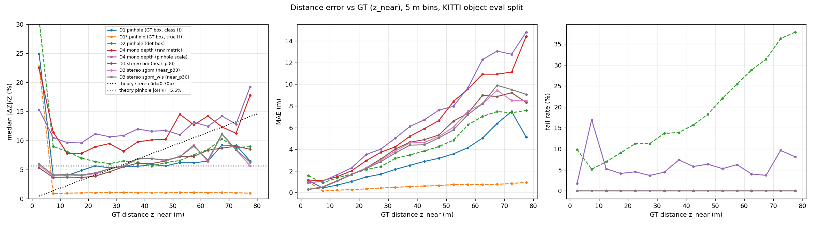
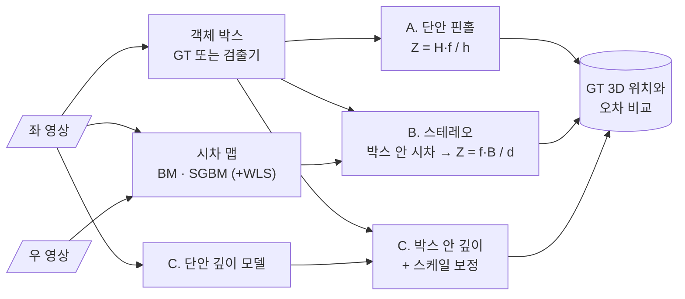

<div align="center">

# 🔭 Mono vs Stereo Distance Estimation

**단안 핀홀 · 스테레오 시차 · 단안 깊이 — 세 가지 거리 추정의 오차 비교**


> 카메라 한 대로 잰 거리와 두 대로 잰 거리는 **어떤 거리에서 누가 더 정확할까?**<br/>
> 산업 컴퓨터비전 Lec 10~11에서 배운 기하를 그대로 실험으로 옮깁니다.

</div>

> [!NOTE]
> ✅ **구현·실험 완료 (2026-10-30).** 아래 결과 요약은 KITTI Object training 홀수 id 3,737 프레임 · 객체 12,783개 기준입니다.
> 전체 표와 그림은 [`results/REPORT.md`](results/REPORT.md)에 있습니다.

## 🏁 결과 요약

| 질문 | 답 |
|---|---|
| 스테레오 시차 알고리즘 | **SGBM**(block 7, 3-way)이 D1-all **7.4%**, EPE 1.44 px로 가장 정확. WLS는 밀도 97%로 빈 곳을 채우지만 D1-all 9.0%로 오히려 나쁨 |
| 객체 시차 추출 | 비교 기준에 따라 최적이 다름. 박스 중심 깊이 → 박스 전체 **중앙값**, 가장 가까운 면 → **가까운 30%(시차 상위 30%) 중앙값** |
| 단안 핀홀 오차의 원인 | 실제 높이를 알면 가장 가까운 면 기준 오차 중앙값 **1.0%**. 오차는 거의 전부 **클래스 평균 높이 가정**(\|δH\|/H 중앙값 5.6%)에서 온다 |
| 교차 거리 `Z*` (GT 박스) | 가장 가까운 면 기준 **≈ 33 m** (이론 31 m), 박스 중심 기준 **≈ 53–54 m** (이론 45 m) |
| 교차 거리 `Z*` (검출 박스) | 가장 가까운 면 기준 **≈ 36–39 m**. 다만 우위는 1 %p 안팎으로 작고 구간에 따라 뒤집히며, 검출 누락이 12.7% |
| 단안 깊이 (Depth Anything V2) | 상대 오차 중앙값 9.8–12.5%로 세 방식 중 가장 나쁨. 핀홀 스케일 보정은 개선 효과 없음 |

**결론.** 가설의 *형태*는 맞습니다. 스테레오 상대 오차는 거리에 비례해 4% → 9%로 커지고, 핀홀(GT 박스)은 60 m대 초반까지 4–6.5%로 거의 평평합니다.
하지만 KITTI의 0.54 m 기준선에서는 교차가 **30 m대 이후**에야 일어나고, 우위의 폭도 GT 박스에서 0.5~2 %p, 검출 박스에서는 그보다 작습니다.
평균 절대 오차(MAE)로 보면 스테레오는 가림·반사로 인한 큰 이상치 때문에 더 일찍(7–19 m) 밀립니다.



> [!IMPORTANT]
> **GT 거리 정의가 결론을 바꿉니다.** KITTI 라벨의 `z`는 3D 박스 *중심*인데, 2D 박스 높이와 스테레오는 모두 *가장 가까운 면*을 봅니다.
> 중심 기준으로 비교하면 핀홀은 약 −2 m(≈ 반 차 길이) 편향을 갖습니다. FCW에 필요한 값은 가장 가까운 면이므로 이를 주 기준(`z_near`, 3D 박스 꼭짓점 중 최소 깊이)으로 삼고, 중심 기준 결과도 함께 보고합니다.
> 또한 KITTI *moderate* 필터(박스 ≥ 25 px)는 45 m 이후 큰 차만 남겨 핀홀 오차를 13%로 부풀리므로 기본 필터에서 뺐습니다 (민감도 표는 보고서 참고).

---

## 📌 문제 정의

FCW v2는 `Z = H_real · fy / h_pixel`(핀홀 모델 + 클래스별 평균 높이)로 거리를 추정합니다. 이 방식은 **높이 가정이 틀리면 거리도 같은 비율로 틀립니다.**
스테레오는 높이 가정 없이 시차로 거리를 구하지만, **멀어질수록 오차가 급격히 커집니다.** 두 방식의 오차 특성을 같은 데이터에서 비교하고, 어느 거리부터 우열이 바뀌는지 찾습니다.

## 🧮 이론적 가설

| 방식 | 거리 식 | 오차 전파 | 예상 |
|---|---|---|---|
| 단안 핀홀 | `Z = H · f / h` | `δZ / Z ≈ δH / H + δh / h` | 상대 오차가 거리와 무관하게 거의 일정 |
| 스테레오 | `Z = f · B / d` | `δZ ≈ (Z² / (f · B)) · δd` | 절대 오차가 거리의 **제곱**에 비례 |

→ **가설:** 가까운 거리에서는 스테레오가 정확하고, 어떤 거리 `Z*`를 넘으면 단안 핀홀의 상대 오차가 더 작아진다. KITTI 스테레오 기준선은 약 0.54 m라서 `Z*`를 실측으로 찾아봅니다.

---

## 🔗 기반 수업과 저장소

| 수업 / 프로젝트 | 가져올 것 | 저장소 |
|---|---|---|
| 산업 컴퓨터비전 Lec 10 | 카메라 행렬, 내부·외부 파라미터, 캘리브레이션 | [industrial_computor_vision](https://github.com/cbnu-yhjeon/industrial_computor_vision) |
| 산업 컴퓨터비전 Lec 11 | 에피폴라 기하, Rectification, 블록 매칭(SSD · SAD · NCC), SGM, 삼각측량 | 〃 |
| 산업 컴퓨터비전 Final | 핀홀 거리 추정 모듈 `calibration.py` | [monocular-forward-collision-warning](https://github.com/cbnu-yhjeon/monocular-forward-collision-warning) |
| 영상처리 실체 | 필터링, 기하 변환 기초 | [Image-Processing-Entities](https://github.com/cbnu-yhjeon/Image-Processing-Entities) |

---

## 🧭 접근 방법



1. **시차 계산:** OpenCV `StereoBM`, `StereoSGBM`, 그리고 `ximgproc` WLS 필터를 비교합니다. 파라미터(`numDisparities`, `blockSize`, `P1`, `P2`)는 KITTI Stereo 2015의 시차 GT로 튜닝합니다.
2. **객체 거리 추출:** 박스 안 시차는 배경(작은 시차)이 섞이므로 **깊이 기준 가까운 30%(= 시차 상위 30%)의 중앙값**을 후보로 두고, 전체 중앙값 · 중앙 50% 영역 중앙값 · 히스토그램 최빈값과 비교합니다 (S2).
3. **단안 핀홀:** 박스 높이와 클래스별 평균 높이로 계산합니다. GT 박스를 쓰는 조건과 검출 박스를 쓰는 조건을 모두 봅니다.
4. **단안 깊이:** Depth Anything V2 Metric-Outdoor-Small(Virtual KITTI 2로만 미세조정, 실제 KITTI 미사용)의 미터 깊이를 그대로 쓴 결과와, 같은 영상의 *다른* 객체들의 핀홀 거리로 스케일을 맞춘 결과(leave-one-out)를 함께 봅니다.

---

## 🗂️ 데이터

| 데이터 | 용도 | 비고 |
|---|---|---|
| [KITTI Stereo 2015](https://www.cvlibs.net/datasets/kitti/eval_scene_flow.php?benchmark=stereo) | 시차 알고리즘 튜닝 · 평가 | 학습 장면 200개, 시차 GT |
| [KITTI Object Detection](https://www.cvlibs.net/datasets/kitti/eval_object.php) | 객체 거리 평가 | 좌·우 영상 + 3D 라벨 + `calib`(P2, P3) |

> 스테레오 기준선 `B`와 초점 거리 `f`는 `calib`의 `P2`, `P3`에서 계산합니다 (`B = −P3[0,3] / P3[0,0] + P2[0,3] / P2[0,0]`).
> KITTI는 **CC BY-NC-SA 3.0**(비상업)입니다.

---

## 🧪 실험 설계

| ID | 내용 | 확인할 것 |
|:---:|---|---|
| S1 | BM vs SGBM vs SGBM + WLS (Stereo 2015) | D1-all, EPE, 처리 시간 |
| S2 | 객체 시차 추출 방식 (중앙값 / 하위 백분위 / 마스크) | 객체 거리 오차 |
| D1 | 단안 핀홀 (GT 박스) | 높이 가정만의 오차 |
| D2 | 단안 핀홀 (검출 박스) | 실제 사용 조건 |
| D3 | 스테레오 (GT 박스 영역) | 시차 오차만의 영향 |
| D4 | 단안 깊이 + 스케일 보정 | 딥러닝 기준선 |

### 지표

- **거리:** MAE, 상대 오차, 구간별(5 m 단위) 오차 곡선 → 교차 거리 `Z*` 추정
- **시차:** D1-all(오차가 3 px 이상이면서 5% 이상인 픽셀 비율), EPE
- **실패율:** 시차가 유효하지 않아 거리를 못 구한 객체 비율
- **속도:** 프레임당 처리 시간

---

## 🗓️ 마일스톤

| 주차 | 내용 | 산출물 | 상태 |
|:---:|---|---|:---:|
| 1 | KITTI 로더, `calib` 파싱, 정렬 확인 | [에피폴라 선 시각화](results/figures/epipolar_000008.jpg) (ORB 매칭 \|Δy\| 중앙값 0.00 px) | ✅ |
| 2 | BM · SGBM · WLS 구현과 튜닝 | [S1 결과표](results/s1_results.csv), [시차 비교](results/figures/disparity_000001.png) | ✅ |
| 3 | 객체 단위 거리 추출 | [S2 결과](results/s2_results.csv) | ✅ |
| 4 | 단안 핀홀 · 스테레오 비교 | D1 ~ D3 오차 곡선, [`Z*`](results/crossover.csv) | ✅ |
| 5 | 단안 깊이 기준선, 정리 | D4, [최종 보고서](results/REPORT.md) | ✅ |

## 📁 디렉토리 구조

```
Mono-Stereo-Distance-Estimation/
├── src/
│   ├── calib.py          KITTI calib 파싱 (f, B)
│   ├── kitti.py          Stereo 2015 · Object 로더, label 파싱, 3D 박스 꼭짓점
│   ├── disparity.py      BM · SGBM · WLS (왼쪽 패딩으로 좌측 띠까지 계산)
│   ├── object_depth.py   박스 → 거리 (세 방식), 시차 집계 방식
│   └── eval.py           D1-all · EPE · 거리 오차 · 구간 곡선 · Z*
├── scripts/
│   ├── prepare_data.sh   KITTI 다운로드 · 압축 해제
│   ├── viz_epipolar.py   정렬 확인 (M1)
│   ├── run_s1.py         S1 튜닝(짝수 장면) · 평가(홀수 장면)
│   ├── viz_disparity.py  S1 정성 비교
│   ├── run_gpu_models.py YOLO11 검출(D2) · Depth Anything V2(D4) 캐시
│   ├── run_objects.py    S2 · D1 ~ D3 객체별 거리
│   └── analyze.py        표 · 곡선 · Z* → results/REPORT.md
├── tests/                pytest 17개 (합성 스테레오 쌍 포함)
├── results/              결과표 · 그림 · REPORT.md
└── README.md
```

## ▶️ 재현

```bash
uv venv .venv --python 3.10
uv pip install -r requirements.txt --index-url https://download.pytorch.org/whl/cu128 --extra-index-url https://pypi.org/simple --index-strategy unsafe-best-match
uv pip install --reinstall opencv-contrib-python-headless==5.0.0.93   # ultralytics가 덮어쓴 cv2 복구 (ximgproc)
.venv/bin/python -m pytest

scripts/prepare_data.sh                      # ~27 GB, KITTI_ROOT 기본값 ~/data/kitti
.venv/bin/python -m scripts.viz_epipolar
.venv/bin/python -m scripts.run_s1           # 약 1분 (CPU 8 workers)
.venv/bin/python -m scripts.viz_disparity
.venv/bin/python -m scripts.run_gpu_models   # 약 15분 (RTX 5060 Ti)
.venv/bin/python -m scripts.run_objects      # 약 3분 (CPU 10 workers)
.venv/bin/python -m scripts.analyze
```

**데이터 분할.** 튜닝·통계에 쓰는 데이터와 평가 데이터를 섞지 않습니다. Stereo 2015는 짝수 장면으로 파라미터를 고르고 홀수 장면으로 평가합니다. Object는 짝수 id로 클래스 평균 높이를 추정하고 홀수 id로 평가합니다.
**처리 시간 (프레임당 중앙값).** BM 25 ms · SGBM 29 ms · SGBM+WLS 69 ms (CPU), YOLO11m 24 ms · Depth Anything V2-S 134 ms (GPU, 전처리 포함).

## ⚠️ 리스크와 대응

| 리스크 | 대응 |
|---|---|
| 텍스처 없는 영역·반사면에서 시차 실패 | 실패율을 따로 보고하고, WLS로 보간한 결과와 비교 |
| 원거리 객체는 시차가 1~2 px 수준 | 서브픽셀 시차(SGBM 기본 1/16 px) 사용, 구간별로 분리 보고 |
| `ximgproc`는 `opencv-contrib-python` 필요 | requirements에 명시 |

## 📚 참고 자료

- H. Hirschmüller, *Stereo Processing by Semiglobal Matching and Mutual Information*, TPAMI 2008
- M. Menze, A. Geiger, *Object Scene Flow for Autonomous Vehicles*, CVPR 2015 (KITTI 2015)
- [OpenCV StereoSGBM](https://docs.opencv.org/4.x/d2/d85/classcv_1_1StereoSGBM.html)
- 산업 컴퓨터비전 Lec 10 · 11 강의 자료
