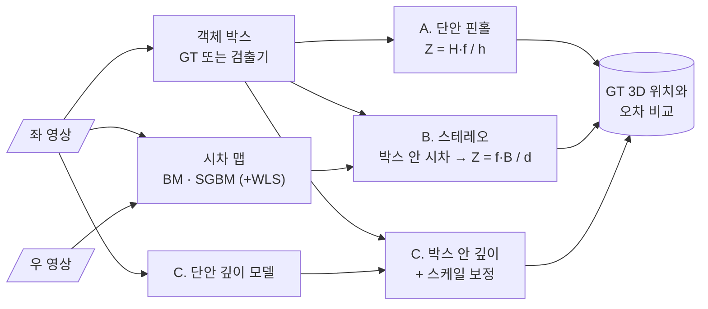

<div align="center">

# 🔭 Mono vs Stereo Distance Estimation

**단안 핀홀 · 스테레오 시차 · 단안 깊이 — 세 가지 거리 추정의 오차 비교**


> 카메라 한 대로 잰 거리와 두 대로 잰 거리는 **어떤 거리에서 누가 더 정확할까?**<br/>
> 산업 컴퓨터비전 Lec 10~11에서 배운 기하를 그대로 실험으로 옮깁니다.

</div>

> [!NOTE]
> 🚧 **계획 단계입니다.** 아직 코드가 없고, 이 README는 프로젝트 설계서입니다.

---

## 📌 문제 정의

FCW v2는 `Z = H_real · fy / h_pixel`(핀홀 모델 + 클래스별 평균 높이)로 거리를 추정합니다. 이 방식은 **높이 가정이 틀리면 거리도 같은 비율로 틀립니다.**
스테레오는 높이 가정 없이 시차로 거리를 구하지만, **멀어질수록 오차가 급격히 커집니다.** 두 방식의 오차 특성을 같은 데이터에서 비교하고, 어느 거리부터 우열이 바뀌는지 찾습니다.

## 🧮 이론적 가설

| 방식 | 거리 식 | 오차 전파 | 예상 |
|---|---|---|---|
| 단안 핀홀 | `Z = H · f / h` | `δZ / Z ≈ δH / H + δh / h` | 상대 오차가 거리와 무관하게 거의 일정 |
| 스테레오 | `Z = f · B / d` | `δZ ≈ (Z² / (f · B)) · δd` | 절대 오차가 거리의 **제곱**에 비례 |

→ **가설:** 가까운 거리에서는 스테레오가 정확하고, 어떤 거리 `Z*`를 넘으면 단안 핀홀의 상대 오차가 더 작아진다. KITTI 스테레오 기준선은 약 0.54 m라서 `Z*`를 실측으로 찾아봅니다.

---

## 🔗 기반 수업과 저장소

| 수업 / 프로젝트 | 가져올 것 | 저장소 |
|---|---|---|
| 산업 컴퓨터비전 Lec 10 | 카메라 행렬, 내부·외부 파라미터, 캘리브레이션 | [industrial_computor_vision](https://github.com/cbnu-yhjeon/industrial_computor_vision) |
| 산업 컴퓨터비전 Lec 11 | 에피폴라 기하, Rectification, 블록 매칭(SSD · SAD · NCC), SGM, 삼각측량 | 〃 |
| 산업 컴퓨터비전 Final | 핀홀 거리 추정 모듈 `calibration.py` | [monocular-forward-collision-warning](https://github.com/cbnu-yhjeon/monocular-forward-collision-warning) |
| 영상처리 실체 | 필터링, 기하 변환 기초 | [Image-Processing-Entities](https://github.com/cbnu-yhjeon/Image-Processing-Entities) |

---

## 🧭 접근 방법



1. **시차 계산:** OpenCV `StereoBM`, `StereoSGBM`, 그리고 `ximgproc` WLS 필터를 비교합니다. 파라미터(`numDisparities`, `blockSize`, `P1`, `P2`)는 KITTI Stereo 2015의 시차 GT로 튜닝합니다.
2. **객체 거리 추출:** 박스 안 시차는 배경이 섞이므로 **하위 백분위수(예: 하위 30%) 시차의 중앙값**을 객체 시차로 씁니다. 이 선택도 실험 변수로 둡니다.
3. **단안 핀홀:** 박스 높이와 클래스별 평균 높이로 계산합니다. GT 박스를 쓰는 조건과 검출 박스를 쓰는 조건을 모두 봅니다.
4. **단안 깊이 (선택):** 상대 깊이 모델에 핀홀 거리로 스케일을 맞춰 세 번째 기준선으로 씁니다.

---

## 🗂️ 데이터

| 데이터 | 용도 | 비고 |
|---|---|---|
| [KITTI Stereo 2015](https://www.cvlibs.net/datasets/kitti/eval_scene_flow.php?benchmark=stereo) | 시차 알고리즘 튜닝 · 평가 | 학습 장면 200개, 시차 GT |
| [KITTI Object Detection](https://www.cvlibs.net/datasets/kitti/eval_object.php) | 객체 거리 평가 | 좌·우 영상 + 3D 라벨 + `calib`(P2, P3) |

> 스테레오 기준선 `B`와 초점 거리 `f`는 `calib`의 `P2`, `P3`에서 계산합니다 (`B = −P3[0,3] / P3[0,0] + P2[0,3] / P2[0,0]`).
> KITTI는 **CC BY-NC-SA 3.0**(비상업)입니다.

---

## 🧪 실험 설계

| ID | 내용 | 확인할 것 |
|:---:|---|---|
| S1 | BM vs SGBM vs SGBM + WLS (Stereo 2015) | D1-all, EPE, 처리 시간 |
| S2 | 객체 시차 추출 방식 (중앙값 / 하위 백분위 / 마스크) | 객체 거리 오차 |
| D1 | 단안 핀홀 (GT 박스) | 높이 가정만의 오차 |
| D2 | 단안 핀홀 (검출 박스) | 실제 사용 조건 |
| D3 | 스테레오 (GT 박스 영역) | 시차 오차만의 영향 |
| D4 | 단안 깊이 + 스케일 보정 | 딥러닝 기준선 |

### 지표

- **거리:** MAE, 상대 오차, 구간별(5 m 단위) 오차 곡선 → 교차 거리 `Z*` 추정
- **시차:** D1-all(오차가 3 px 이상이면서 5% 이상인 픽셀 비율), EPE
- **실패율:** 시차가 유효하지 않아 거리를 못 구한 객체 비율
- **속도:** 프레임당 처리 시간

---

## 🗓️ 마일스톤

| 주차 | 내용 | 산출물 |
|:---:|---|---|
| 1 | KITTI 로더, `calib` 파싱, 정렬 확인 | 에피폴라 선 시각화 |
| 2 | BM · SGBM · WLS 구현과 튜닝 | S1 결과표 |
| 3 | 객체 단위 거리 추출 | S2 결과 |
| 4 | 단안 핀홀 · 스테레오 비교 | D1 ~ D3 오차 곡선, `Z*` |
| 5 | 단안 깊이 기준선 (선택), 정리 | D4, 최종 보고서 |

## 📁 디렉토리 구조 (계획)

```
Mono-Stereo-Distance-Estimation/
├── src/
│   ├── calib.py          KITTI calib 파싱 (f, B)
│   ├── disparity.py      BM · SGBM · WLS
│   ├── object_depth.py   박스 → 거리 (세 방식)
│   └── eval.py           D1-all · EPE · 거리 오차
├── notebooks/            오차 곡선, 실패 사례
├── results/
└── README.md
```

## ⚠️ 리스크와 대응

| 리스크 | 대응 |
|---|---|
| 텍스처 없는 영역·반사면에서 시차 실패 | 실패율을 따로 보고하고, WLS로 보간한 결과와 비교 |
| 원거리 객체는 시차가 1~2 px 수준 | 서브픽셀 시차(SGBM 기본 1/16 px) 사용, 구간별로 분리 보고 |
| `ximgproc`는 `opencv-contrib-python` 필요 | requirements에 명시 |

## 📚 참고 자료

- H. Hirschmüller, *Stereo Processing by Semiglobal Matching and Mutual Information*, TPAMI 2008
- M. Menze, A. Geiger, *Object Scene Flow for Autonomous Vehicles*, CVPR 2015 (KITTI 2015)
- [OpenCV StereoSGBM](https://docs.opencv.org/4.x/d2/d85/classcv_1_1StereoSGBM.html)
- 산업 컴퓨터비전 Lec 10 · 11 강의 자료
