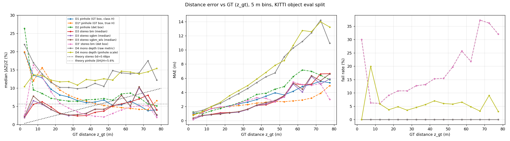
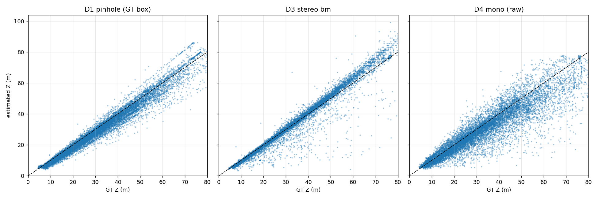

# 결과 보고서 (자동 생성: `scripts/analyze.py`)

- 평가 객체: **12783**개 / 3737 프레임 (KITTI object training 홀수 id, 가림 ≤ 1 · 잘림 ≤ 0.3, Z ≤ 80 m)
- 클래스별 객체 수: Car 9517, Pedestrian 1700, Van 658, Cyclist 526, Truck 382
- 클래스 평균 높이 (짝수 id에서 추정): Pedestrian 1.76 m, Car 1.53 m, Van 2.22 m, Truck 3.26 m, Cyclist 1.74 m

## S1. 시차 알고리즘 (Stereo 2015, 테스트 100장)

| method | block_size | d1_all | d1_noc | epe | d1_valid | density | time_ms |
|---|---|---|---|---|---|---|---|
| bm | 15 | 13.74 | 13.32 | 3.18 | 4.82 | 47.18 | 24.73 |
| sgbm | 7 | 7.43 | 6.88 | 1.44 | 4.92 | 93.37 | 28.93 |
| sgbm_wls | 7 | 8.99 | 8.44 | 1.80 | 7.58 | 97.45 | 69.21 |

D1/D1_valid/density 단위 %, EPE px. `d1_all`·`epe`는 KITTI 방식(무효 픽셀을 배경 보간), `d1_valid`는 유효 예측만.

## S2. 객체 시차 추출 방식 (GT 박스)

| stereo | aggregator | mae(z_gt) | mae(z_near) | rel_median(z_gt) | rel_median(z_near) | fail_rate |
|---|---|---|---|---|---|---|
| bm | center_median | 2.04 | 2.45 | 4.23 | 5.78 | 0.13 |
| bm | hist_mode | 2.23 | 2.72 | 4.37 | 5.92 | 0.00 |
| bm | median | 1.89 | 2.63 | 3.76 | 7.11 | 0.00 |
| bm | near_p30 | 3.54 | 3.23 | 5.93 | 4.99 | 0.00 |
| sgbm | center_median | 1.94 | 2.43 | 4.18 | 6.19 | 0.02 |
| sgbm | hist_mode | 2.18 | 2.78 | 4.51 | 6.33 | 0.00 |
| sgbm | median | 1.82 | 2.70 | 4.01 | 7.97 | 0.00 |
| sgbm | near_p30 | 3.45 | 3.15 | 6.05 | 5.19 | 0.00 |
| sgbm_wls | center_median | 1.92 | 2.46 | 4.13 | 6.22 | 0.05 |
| sgbm_wls | hist_mode | 2.24 | 2.83 | 4.46 | 6.24 | 0.00 |
| sgbm_wls | median | 1.89 | 2.77 | 4.08 | 7.96 | 0.00 |
| sgbm_wls | near_p30 | 3.31 | 3.09 | 5.75 | 5.28 | 0.00 |

`z_gt` = 3D 박스 중심 깊이(라벨), `z_near` = 가장 가까운 꼭짓점 깊이(스테레오가 실제로 보는 표면에 가까움). rel_median은 %, MAE는 m.

방식별 최적 집계: bm → `median`, sgbm → `median`, sgbm_wls → `median`

## D1–D4. 객체 거리 오차 (전체)

| method | n | fail_rate | mae | bias | rel_mean | rel_median |
|---|---|---|---|---|---|---|
| D1 pinhole (GT box, class H) | 12783 | 0.00 | 2.60 | -1.90 | 9.83 | 8.28 |
| D1* pinhole (GT box, true H) | 12783 | 0.00 | 2.18 | -2.18 | 8.93 | 7.26 |
| D2 pinhole (det box) | 12783 | 12.67 | 2.79 | -0.84 | 9.92 | 7.37 |
| D3 stereo bm (median) | 12783 | 0.00 | 1.89 | -0.09 | 6.23 | 3.76 |
| D3 stereo sgbm (median) | 12783 | 0.00 | 1.82 | 0.30 | 6.02 | 4.01 |
| D3 stereo sgbm_wls (median) | 12783 | 0.00 | 1.89 | 0.33 | 6.23 | 4.08 |
| D3' stereo bm (det box) | 12783 | 12.67 | 2.47 | -1.75 | 9.74 | 5.20 |
| D4 mono depth (raw metric) | 12783 | 0.00 | 4.61 | -2.88 | 15.17 | 12.53 |
| D4 mono depth (pinhole scale) | 12783 | 6.56 | 4.98 | -2.33 | 15.95 | 12.53 |

rel은 |Ẑ−Z|/Z (%), bias = 평균(Ẑ−Z) m, fail_rate = 거리를 못 구한 비율 % (D2/D3'는 검출 누락 포함, D4 scale은 한 장면에 객체가 1개뿐이면 실패).

검출기 매칭(IoU ≥ 0.5) 재현율: **87.3%**. 매칭된 객체만 비교:

| method | n | fail_rate | mae | bias | rel_mean | rel_median |
|---|---|---|---|---|---|---|
| D1 pinhole (GT box) | 11163 | 0.00 | 2.57 | -1.97 | 10.18 | 8.80 |
| D2 pinhole (det box) | 11163 | 0.00 | 2.79 | -0.84 | 9.92 | 7.37 |
| D3 stereo bm (GT box) | 11163 | 0.00 | 1.48 | 0.12 | 5.36 | 3.56 |
| D3' stereo bm (det box) | 11163 | 0.00 | 2.47 | -1.75 | 9.74 | 5.20 |

### 클래스별

| class | method | n | fail_rate | mae | bias | rel_median |
|---|---|---|---|---|---|---|
| Car | D1 pinhole | 9517 | 0.00 | 2.69 | -2.19 | 9.13 |
| Car | D3 stereo bm | 9517 | 0.00 | 1.92 | -0.06 | 4.15 |
| Cyclist | D1 pinhole | 526 | 0.00 | 1.37 | -0.73 | 5.38 |
| Cyclist | D3 stereo bm | 526 | 0.00 | 1.93 | 0.70 | 3.21 |
| Pedestrian | D1 pinhole | 1700 | 0.00 | 1.02 | -0.47 | 5.77 |
| Pedestrian | D3 stereo bm | 1700 | 0.00 | 0.86 | 0.22 | 1.89 |
| Truck | D1 pinhole | 382 | 0.00 | 5.69 | -3.07 | 12.12 |
| Truck | D3 stereo bm | 382 | 0.00 | 3.59 | -2.19 | 5.57 |
| Van | D1 pinhole | 658 | 0.00 | 4.63 | -1.75 | 12.17 |
| Van | D3 stereo bm | 658 | 0.00 | 3.03 | -0.83 | 5.59 |

## GT = 가장 가까운 면 깊이(z_near)로 볼 때

전방 충돌 경고에 실제로 필요한 값은 박스 중심이 아니라 가장 가까운 면까지의 거리다. 스테레오 집계 방식도 이 기준으로 다시 골랐다: bm → `near_p30`, sgbm → `near_p30`, sgbm_wls → `near_p30`

| method | n | fail_rate | mae | bias | rel_mean | rel_median |
|---|---|---|---|---|---|---|
| D1 pinhole (GT box, class H) | 12783 | 0.00 | 1.93 | -0.12 | 6.56 | 5.33 |
| D1* pinhole (GT box, true H) | 12783 | 0.00 | 0.43 | -0.40 | 1.82 | 1.04 |
| D2 pinhole (det box) | 12783 | 12.67 | 2.64 | 0.98 | 10.29 | 7.07 |
| D4 mono depth (raw metric) | 12783 | 0.00 | 4.00 | -1.10 | 13.68 | 9.76 |
| D4 mono depth (pinhole scale) | 12783 | 6.56 | 4.50 | -0.51 | 15.08 | 10.90 |
| D3 stereo bm (near_p30) | 12783 | 0.00 | 3.23 | -1.01 | 10.31 | 4.99 |
| D3 stereo sgbm (near_p30) | 12783 | 0.00 | 3.15 | -0.82 | 10.21 | 5.19 |
| D3 stereo sgbm_wls (near_p30) | 12783 | 0.00 | 3.09 | -0.63 | 10.01 | 5.28 |

## 교차 거리 Z*

| stereo | vs | metric | Z*(z_gt) | Z*(z_near) |
|---|---|---|---|---|
| bm | D1 GT box | rel_median | 54.2 | 33.1 |
| bm | D1 GT box | mae | 53.1 | 7.2 |
| bm | D2 det box | rel_median | 68.2 | 38.9 |
| bm | D2 det box | mae | 72.0 | 18.9 |
| bm | D4 raw | rel_median | – | – |
| bm | D4 raw | mae | – | – |
| sgbm | D1 GT box | rel_median | 52.5 | 10.3 |
| sgbm | D1 GT box | mae | 53.6 | 7.0 |
| sgbm | D2 det box | rel_median | 65.4 | 35.5 |
| sgbm | D2 det box | mae | 77.2 | 18.4 |
| sgbm | D4 raw | rel_median | – | – |
| sgbm | D4 raw | mae | – | – |
| sgbm_wls | D1 GT box | rel_median | 52.5 | 7.5 |
| sgbm_wls | D1 GT box | mae | 52.9 | 6.9 |
| sgbm_wls | D2 det box | rel_median | 65.2 | 35.5 |
| sgbm_wls | D2 det box | mae | 75.0 | 19.3 |
| sgbm_wls | D4 raw | rel_median | – | – |
| sgbm_wls | D4 raw | mae | – | – |

### 필터 민감도: moderate(박스 ≥ 25 px)를 쓰면 (z_near 기준 rel_median %)

| bin_mid | moderate(≥25px):pin_gt | moderate(≥25px):st_bm_near_p30 | moderate(≥25px):st_sgbm_near_p30 | moderate(≥25px):st_sgbm_wls_near_p30 | visible:pin_gt | visible:st_bm_near_p30 | visible:st_sgbm_near_p30 | visible:st_sgbm_wls_near_p30 |
|---|---|---|---|---|---|---|---|---|
| 2.5 | 25.0 | 5.3 | 5.7 | 6.0 | 25.0 | 5.3 | 5.7 | 6.0 |
| 7.5 | 4.0 | 3.7 | 3.9 | 4.1 | 4.0 | 3.7 | 3.9 | 4.1 |
| 12.5 | 4.0 | 3.7 | 4.1 | 4.2 | 4.0 | 3.7 | 4.1 | 4.2 |
| 17.5 | 4.9 | 3.6 | 4.0 | 4.1 | 4.9 | 3.6 | 4.0 | 4.1 |
| 22.5 | 5.7 | 3.9 | 4.3 | 4.4 | 5.7 | 3.9 | 4.3 | 4.4 |
| 27.5 | 5.3 | 4.6 | 5.2 | 5.1 | 5.3 | 4.6 | 5.2 | 5.1 |
| 32.5 | 5.6 | 5.5 | 5.6 | 5.6 | 5.6 | 5.5 | 5.6 | 5.6 |
| 37.5 | 5.6 | 6.1 | 6.8 | 6.9 | 5.6 | 6.1 | 6.8 | 6.9 |
| 42.5 | 5.9 | 6.0 | 6.6 | 6.6 | 5.9 | 6.0 | 6.9 | 6.9 |
| 47.5 | 8.6 | 6.3 | 6.2 | 6.3 | 5.6 | 6.5 | 6.5 | 6.6 |
| 52.5 | 13.3 | 7.2 | 7.7 | 7.6 | 6.2 | 7.3 | 7.2 | 7.2 |
| 57.5 | 13.1 | 8.1 | 8.7 | 9.7 | 6.2 | 7.3 | 9.3 | 9.0 |
| 62.5 | 13.1 | 8.9 | 6.5 | 8.5 | 6.5 | 8.3 | 6.3 | 6.6 |
| 67.5 | 13.2 | 8.6 | 10.9 | 10.8 | 9.2 | 8.7 | 11.0 | 11.2 |
| 72.5 | 13.2 | 8.9 | 9.0 | 9.0 | 9.2 | 9.0 | 8.4 | 8.4 |
| 77.5 | – | – | – | – | 6.5 | 8.5 | 5.6 | 6.3 |

moderate 필터에서는 약 45 m 이후 평균 높이 승용차(약 22 px)가 빠지고 큰 차만 남아 핀홀 오차가 13% 근처로 뛴다. 측정 오차가 아니라 표본 선택 효과다.

구간(5 m)별 지표에서 스테레오가 더 나은 상태에서 단안이 더 나아지는 첫 거리 (선형 보간, 구간당 n ≥ 20). – = 교차 없음.

### 이론 대비

- 높이 가정 오차 중앙값 |δH|/H ≈ **5.6%** → 핀홀 상대 오차의 바닥 (f·B 중앙값 384.4 px·m)

- 기준 `z_gt`: 최적 스테레오 bm/median의 시차 오차 중앙값 δd ≈ **0.48 px** → 이론 교차점 Z* = f·B·(δH/H)/δd ≈ **45.4 m**
- 기준 `z_near`: 최적 스테레오 bm/near_p30의 시차 오차 중앙값 δd ≈ **0.70 px** → 이론 교차점 Z* = f·B·(δH/H)/δd ≈ **30.9 m**

## 그림

